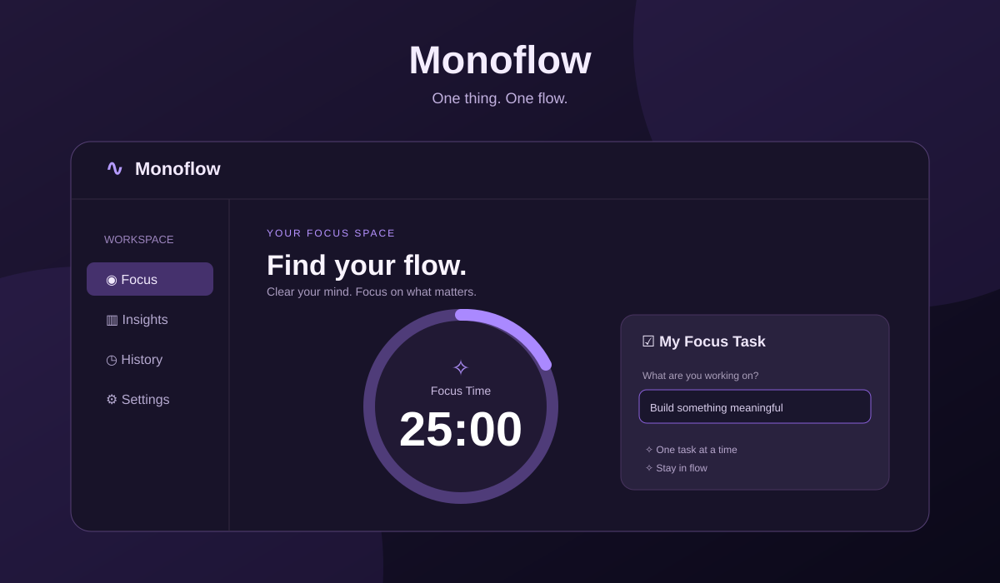

# Monoflow

**One thing. One flow.** A beautiful, privacy-first focus timer and single-task productivity tracker. Built with React, TypeScript (TSX), Vite, and an optional Python/FastAPI insights endpoint.



## Features

- **Focus timer** — 25-minute focus, 50-minute deep work, and 5-minute break presets; pause, resume, and reset.
- **Single-task focus** — set one intention and attach it to completed sessions.
- **Insights** — daily focus time, session counts, current streak, and a seven-day chart.
- **History** — timestamped session log with JSON backup/import.
- **Offline PWA** — installable, home-screen icon, standalone display, and service-worker caching.
- **Privacy-first** — no account, trackers, required backend, or server data storage. Data stays on your device.
- **Optional Python API** — stateless FastAPI endpoint to calculate session insights locally.
- **Responsive UI** — dark violet interface designed for desktop, tablet, and mobile.

## Get started

You need Node.js 20.19+ or 22.12+.

```bash
npm install
npm run dev
```

Open the URL printed by Vite (usually `http://localhost:5173`). To check a production build:

```bash
npm run build
npm run preview
```

### Optional Python service

Python 3.10+ is recommended. The frontend works without the API. To enable Python-powered insights:

```bash
python -m venv .venv
# On Windows: .venv\\Scripts\\activate
# On macOS/Linux: source .venv/bin/activate
pip install -r api/requirements.txt
uvicorn api.main:app --host 127.0.0.1 --port 8000
```

Copy `.env.example` to `.env.local` and run the frontend. Open **Insights** and select **Analyze with Python API**. The API only receives session dates and durations when you press the button. It does not store data. For local development only: before public deployment, review origin restrictions, HTTPS, and authentication if you add persistence.

## Install as an app

From a deployed HTTPS site, use your browser's **Install app** option. On iPhone/iPad use **Share → Add to Home Screen**. After the first successful load, the app shell works offline. Browser limitations and operating-system settings can affect background timers, sounds, and notifications.

## Deploy on GitHub Pages

1. Open repository **Settings → Pages**.
2. Under **Build and deployment**, choose **GitHub Actions**.
3. Push to `main`. The included workflow builds the PWA and deploys `dist/`.
4. Open `https://mattboneo-30.github.io/MonoFlow/` after the workflow completes.

The default workflow deploys **only the static React PWA**, not the optional Python service. Frontend assets use relative paths for compatibility with GitHub Pages project hosting.

## Storage and reliability

Sessions and preferences use browser `localStorage`. They may be removed when browser data is cleared; use **Settings → Export backup** regularly. Pausing/reopening a running timer uses an absolute deadline to avoid tab-throttling drift, and finished sessions are deduplicated. A session is recorded only when a focus timer naturally reaches zero; breaks don't count.

## Project structure

```text
src/App.tsx            Main app screens, timer, controls, and PWA install UX
src/storage.ts        Local persistence and session/streak calculations
src/style.css         Responsive dark-violet visual system
public/               PWA icons, app preview, favicon
api/main.py           Optional stateless FastAPI insights service
.github/workflows/    GitHub Pages build/deploy
```

## License

MIT — see [LICENSE](LICENSE).
